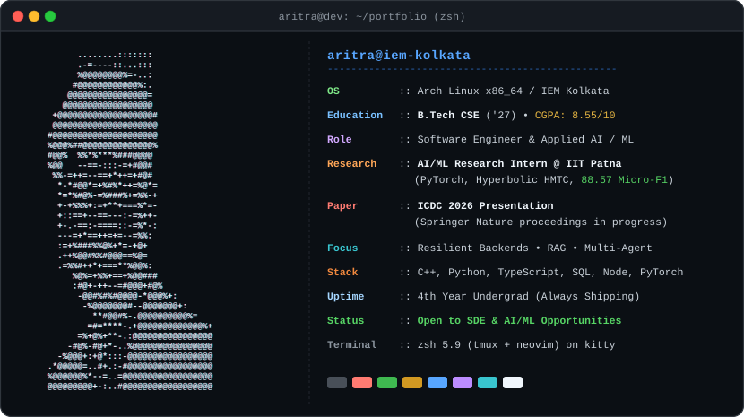

<p align="center">
  
</p>

<p align="center">
  <strong>Final-Year CSE Undergrad @ IEM Kolkata ('27) &nbsp;•&nbsp; Ex-AI/ML Research Intern @ IIT Patna &nbsp;•&nbsp; Author @ ICDC 2026 (Springer Nature)</strong>
  <br />
  <em>Building resilient backend systems, distributed architectures, and production-grade agentic AI applications.</em>
</p>

<p align="center">
  <a href="https://linkedin.com/in/aritra-chowdhury-82201228b"></a>
  <a href="https://leetcode.com/u/Aritra-RickC2004"></a>
  <a href="https://github.com/Aritra-rickc2004"></a>
  <a href="mailto:tchowdhury979@gmail.com"></a>
</p>

---

### 🛠️ Tech Stack & Capabilities

<div align="center">

<p><strong>Languages &amp; Core</strong></p>
<a href="https://skillicons.dev">
  
</a>

<p><strong>Backend, Infrastructure &amp; Persistence</strong></p>
<a href="https://skillicons.dev">
  
</a>

<p><strong>AI, Applied ML &amp; Frameworks</strong></p>
<a href="https://skillicons.dev">
  
</a>

<p><strong>DevOps, Tooling &amp; Environment</strong></p>
<a href="https://skillicons.dev">
  
</a>

</div>

<br />

| Domain | Key Technologies & Methodologies |
| :--- | :--- |
| **Backend & Systems** | Node.js, Express.js, RESTful APIs, Inngest (Durable Execution), Drizzle ORM, Event-Driven Architecture, Argon2id Session Security |
| **Agentic AI & RAG** | LangGraph (State Graphs), LangChain, FAISS Vector Search, Google Gemini API, Sentence-Transformers, Pydantic Schema Contracts |
| **Research & Modeling** | PyTorch, Hierarchical Multi-Label Classification (HMTC), Hyperbolic Embeddings, Structure-Aware Pruning |
| **Core CS & Testing** | Data Structures & Algorithms, Object-Oriented Programming (OOP), DBMS, Vitest & Supertest (41/41 Pass) |

---

### 🚀 Featured Engineering Projects

#### 1. 🏥 [Medi-AI-Agent](https://github.com/Aritra-rickc2004/Medi-AI-Agent) &nbsp;`·`&nbsp; Multi-Agent Clinical Coordination &amp; Adherence Platform
> *Autonomous multi-agent healthcare architecture orchestrating clinical safety checks, drug-drug interaction detection, and personalized patient adherence.*

```
Architecture :: 3-Agent State Graph (Monitor, Nurse, Medication Manager) via LangGraph
Retrieval    :: Top-k FAISS vector search over pharmacological clinical knowledge bases
Benchmarks   :: <10ms local deterministic rule checks | ~2.5s end-to-end resolution
Validation   :: Evaluated on 100 patient profiles across ~15,000 schedule records
Publication  :: Accepted & presented at 4th ICDC 2026 (Springer Nature proceedings in progress)
Stack        :: Python • LangGraph • LangChain • FAISS • Gemini 2.5 Flash • Streamlit • Pydantic
```
👉 **[View Medi-AI-Agent Repository →](https://github.com/Aritra-rickc2004/Medi-AI-Agent)**

---

#### 2. 🐞 [BugX](https://github.com/BlackClover-pvt/BugX) &nbsp;`·`&nbsp; Full-Stack AI Automated Code Review &amp; Static Analysis Platform
> *Production-grade static analysis platform performing multi-dimensional code reviews across 17+ languages with zero client-parsing failure.*

```
AI Fallback  :: Cascading provider adapter (Gemini 2.5 Flash → Flash-Lite → Flash-Latest)
Type Safety  :: Strict runtime validation of structured JSON output via Zod schemas
Data & Auth  :: Drizzle ORM + PostgreSQL schema; Argon2id password hashing; HTTP-only sessions
Testing      :: 41/41 passing unit and integration tests built with Vitest & Supertest
Stack        :: TypeScript • React 19 • Node.js • Express • PostgreSQL • Drizzle ORM • Vitest • Argon2id
```
👉 **[View BugX Repository →](https://github.com/BlackClover-pvt/BugX)**

---

#### 3. ⚡ [Lysiq AI (Lycic AI)](https://github.com/Aritra-rickc2004/Lysiq-AI) &nbsp;`·`&nbsp; Autonomous Incident Triage &amp; Specialist Routing Platform
> *Event-driven incident management SaaS that decouples ticket submission from heavy AI classification and routing.*

```
Ingestion    :: Decoupled pipeline via Inngest durable step functions (<80ms REST client ACK)
AI Engine    :: Gemini 3.5 Flash extraction under 3.5s timeout guard with 4-domain heuristic fallback
Routing      :: Sub-millisecond dispatch powered by PostgreSQL GIN-indexed array-overlap (&&) queries
Experience   :: Desktop-first workspace with OS-aware Ctrl+K command palette and Axios interceptors
Stack        :: TypeScript • React 18 • Node.js • Express 5 • Supabase (PostgreSQL) • Inngest • Gemini API
```
👉 **[View Lysiq AI Repository →](https://github.com/Aritra-rickc2004/Lysiq-AI)**

---

### 📊 GitHub Activity & Statistics

<div align="center">


&nbsp;


</div>

---

### 📬 Connect & Opportunities

<div align="center">

I am actively seeking **Software Development Engineer (SDE)**, **Backend Engineering**, and **Applied AI** roles starting upon graduation in 2027, as well as high-impact engineering internships.

<br />

<a href="https://linkedin.com/in/aritra-chowdhury-82201228b"></a>
&nbsp;
<a href="https://leetcode.com/u/Aritra-RickC2004"></a>
&nbsp;
<a href="https://github.com/Aritra-rickc2004"></a>
&nbsp;
<a href="mailto:tchowdhury979@gmail.com"></a>

<br /><br />

📍 **Kolkata, West Bengal, India** &nbsp;•&nbsp; 🎓 **B.Tech CSE (2023 – 2027)** &nbsp;•&nbsp; ✉️ **tchowdhury979@gmail.com**

</div>
