  

  
  
  
  

---

### 🛠️ Tech Stack & Capabilities

<strong>Languages &amp; Core Systems</strong>

<strong>Backend Architecture &amp; Databases</strong>

<strong>AI/ML &amp; Full-Stack Frameworks</strong>

<strong>Developer Tooling &amp; Environment</strong>

 

| Domain | Key Technologies & Methodologies |
| :--- | :--- |
| **Backend & Systems** | Node.js, Express.js, RESTful APIs, Inngest (Durable Execution), Drizzle ORM, Argon2id Security |
| **Agentic AI & RAG** | LangGraph (State Graphs), LangChain, FAISS Vector Search, Gemini API, Pydantic Schema Contracts |
| **Research & Modeling** | PyTorch, Hierarchical Multi-Label Classification (HMTC), Hyperbolic Embeddings (88.57 F1) |
| **Core CS & Testing** | Data Structures & Algorithms, Object-Oriented Programming (OOP), DBMS, Vitest & Supertest (41/41 Pass) |

---

### 🚀 Featured Engineering Projects

- 🏥 **[Medi-AI-Agent](https://github.com/Aritra-rickc2004/Medi-AI-Agent)** — Autonomous 3-agent clinical coordination system (`LangGraph` + `FAISS` RAG). Evaluated across 100 patient profiles (~15,000 schedule rows) with `<10ms` local rule checks; paper presented at **ICDC 2026 (Springer Nature proceedings)**.  
  *Stack: Python • LangGraph • LangChain • FAISS • Gemini 2.5 Flash • Streamlit • Pydantic*

- 🐞 **[BugX](https://github.com/BlackClover-pvt/BugX)** — Production AI automated code reviewer for 17+ languages. Built with cascading fallback chains (`Gemini 2.5 Flash → Lite → Latest`), runtime **Zod** schema contracts, Argon2id session security, and **41/41 passing unit/integration tests**.  
  *Stack: TypeScript • React 19 • Node.js • Express • PostgreSQL • Drizzle ORM • Vitest*

- ⚡ **[Lysiq AI (Lycic AI)](https://github.com/Aritra-rickc2004/Lysiq-AI)** — Event-driven incident triage SaaS decoupling ticket ingestion via **Inngest durable step functions** (`<80ms` ACK) with Gemini classification and PostgreSQL GIN-indexed array-overlap (`&&`) specialist routing.  
  *Stack: TypeScript • React 18 • Node.js • Express 5 • Supabase (PostgreSQL) • Inngest • Gemini API*

- 🩺 **[CuraCore HealthBot](https://github.com/BlackClover-pvt/CuraCore)** — Conversational clinical AI assistant running real-time RAG over medical literature via `FAISS` vector search, persistent multi-turn context memory buffers, and Google Maps API healthcare facility routing.  
  *Stack: Python • LangChain • Gemini API • FAISS • Firebase • React.js • Streamlit*

---

### 📬 Connect & Opportunities

**Actively seeking Full-Time SDE, Backend Engineering & Applied AI Roles (Graduating 2027)**

&nbsp;

&nbsp;

&nbsp;

 

📍 **Kolkata, West Bengal, India** &nbsp;•&nbsp; 🎓 **B.Tech CSE @ IEM Kolkata ('27)** &nbsp;•&nbsp; ✉️ **tchowdhury979@gmail.com**

